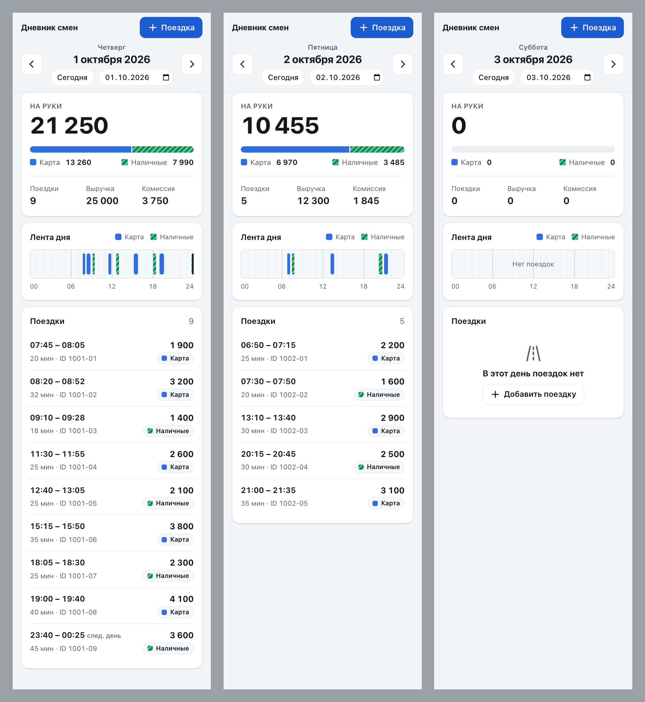

# Дневник смен водителя

Сервер на FastAPI + SQLite и одностраничный клиент. Показывает поездки водителя за выбранный день и сводку: число поездок, выручка, комиссия, «на руки», разбивка наличные/карта. Поездки добавляются через API с проверкой данных и защитой от дублей.



Остальные скриншоты: тёмная тема, десктоп, форма с ошибками и защита от дублей. Все они в [docs/screenshots](docs/screenshots/README.md).

## Запуск

```bash
docker compose up --build
```

Откройте http://localhost:8000. В Docker при старте загружается [data/demo-trips.json](data/demo-trips.json), данные есть за **1–5 октября 2026**. В нём есть поездка через полночь, день с паузами и пустой день (3 октября). Пример из задания лежит отдельно, в [data/trips.json](data/trips.json): его загружает локальный запуск без Docker. Без `?date=` клиент открывает сегодняшний день, и он может быть пустым. Сразу на день с данными: http://localhost:8000/?date=2026-10-01.

База лежит в Docker-томе `db` и не пропадает при перезапуске. Начать с чистой базы: `docker compose down -v`.

### Без Docker

Нужен [uv](https://docs.astral.sh/uv/).

```bash
uv sync
uv run uvicorn app.main:app      # http://localhost:8000
uv run pytest                    # тесты
```

### Настройки (переменные окружения)

| Имя | По умолчанию | Смысл |
|---|---|---|
| `DAY_TZ_OFFSET` | `+05:00` | Смещение, в котором считается «день», строго `±HH:MM`. При неверном значении сервер не стартует. |
| `TRIPS_FILE` | `data/trips.json` | JSON-файл, который загружается при старте. |
| `DB_PATH` | `data/trips.db` | Файл SQLite. |

## API

### `GET /api/days/{date}`

`date` — это `YYYY-MM-DD` или `today` (сегодня в поясе `DAY_TZ_OFFSET`).

```json
{
  "date": "2026-10-01",
  "summary": {
    "trips_count": 2, "revenue": 3900, "commission": 585, "net": 3315,
    "by_payment": {
      "cash": {"trips_count": 1, "revenue": 1500, "commission": 225, "net": 1275},
      "card": {"trips_count": 1, "revenue": 2400, "commission": 360, "net": 2040}
    }
  },
  "trips": [
    {"id": "t1", "start": "2026-10-01T08:10:00+05:00", "end": "2026-10-01T08:32:00+05:00",
     "amount": 2400, "payment": "card", "commission": 360}
  ]
}
```

- Поездки отсортированы по началу.
- День без поездок возвращает `200` с нулями, а не `404`.
- Неверная дата возвращает `422`.

### `POST /api/trips`

```bash
curl -i -X POST localhost:8000/api/trips -H 'Content-Type: application/json' -d '{
  "id": "t100", "start": "2026-10-04T10:00:00+05:00", "end": "2026-10-04T10:20:00+05:00",
  "amount": 1000, "payment": "cash", "commission": 150}'
```

| Ответ | Когда |
|---|---|
| `201` | Новая поездка. |
| `200` | Тот же `id` и те же данные: повтор. Возвращается уже сохранённая поездка, дубль не создаётся. Время сравнивается как момент, поэтому `08:10+05:00` и `03:10Z` считаются одним временем. |
| `409` | Тот же `id`, но другие данные. |
| `422` | Данные не прошли проверку. Ответ в стандартном формате FastAPI с понятным `msg`. |

Правила проверки:
- все поля обязательны, лишние поля запрещены;
- `id` — строка длиной 1–64 символа;
- `start` и `end` — строки ISO 8601 обязательно со смещением, `end > start`;
- `amount` и `commission` — целые числа JSON (`2400.0`, `"2400"` и `true` не принимаются);
- `amount > 0`, `0 ≤ commission ≤ amount`;
- `payment` — ровно `cash` или `card`.

## Что сделано

- API дня: сводка и поездки одним ответом.
- Добавление поездки с проверкой данных.
- Защита от дублей на уровне БД: `PRIMARY KEY (id)`. Сначала выполняется `INSERT`; если он падает с `IntegrityError`, сохранённая запись сравнивается с новой. Схемы «сначала проверить, потом вставить» нет.
- Клиент: сводка, разбивка наличные/карта, список поездок, переход по дням кнопками и выбором даты. Выбранный день хранится в URL.
- Файл с поездками загружается при старте через ту же модель и ту же функцию сохранения, что и `POST`. Повторный старт не создаёт дублей. Плохие записи пропускаются, итог пишется в лог: `added 7, unchanged 0, rejected 0`.
- Тесты, 58 штук: расчёт сводки, дубли, границы дня, проверка данных, загрузка файла. Писались тест-первым.

## Допущения

1. **День** определяется по времени начала поездки в поясе `DAY_TZ_OFFSET` (`+05:00`, как в примере данных). Поездка 23:50–00:15 относится к дню, в который началась. Используется фиксированное смещение, а не IANA-зона, поэтому база `tzdata` не нужна.
2. **«На руки»** = выручка − комиссия. Разбивка по способу оплаты показывает число поездок, выручку, комиссию и «на руки». Сколько получено наличными, видно в строке «Наличные», в колонке «Выручка».
3. **Деньги** — целые числа в единицах исходных данных. Валюта не указывается.
4. **`id`** поездки задаёт клиент. Без него нельзя отличить повторную отправку от новой поездки. Поездка с другим `id` и тем же содержимым — это другая поездка.
5. Время хранится в UTC, а в ответах отдаётся в поясе `DAY_TZ_OFFSET`. Смещение, в котором клиент прислал время, не сохраняется.
6. В [data/trips.json](data/trips.json) есть пример из задания и несколько выдуманных поездок. Среди них поездка через полночь и поездка со временем в UTC.

## Структура

```
app/main.py      маршруты, старт приложения, раздача клиента
app/models.py    модели и правила проверки
app/db.py        SQLite: схема, сохранение с защитой от дублей, выборка дня
app/summary.py   расчёт сводки
app/seed.py      загрузка JSON-файла
app/config.py    настройки
static/index.html  клиент (HTML + JS без сборки)
tests/           pytest
docs/PLAN.md     план и принятые решения
```
