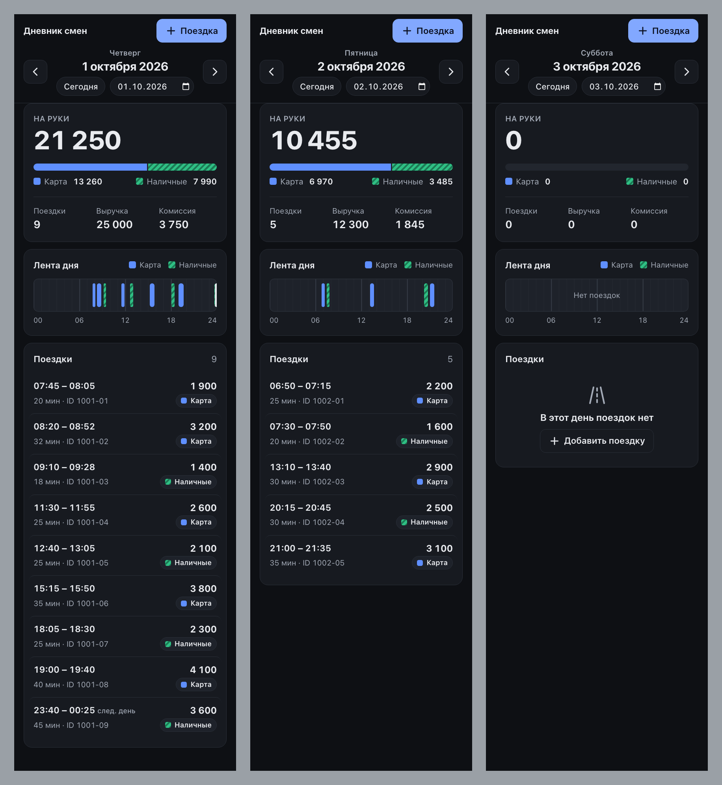
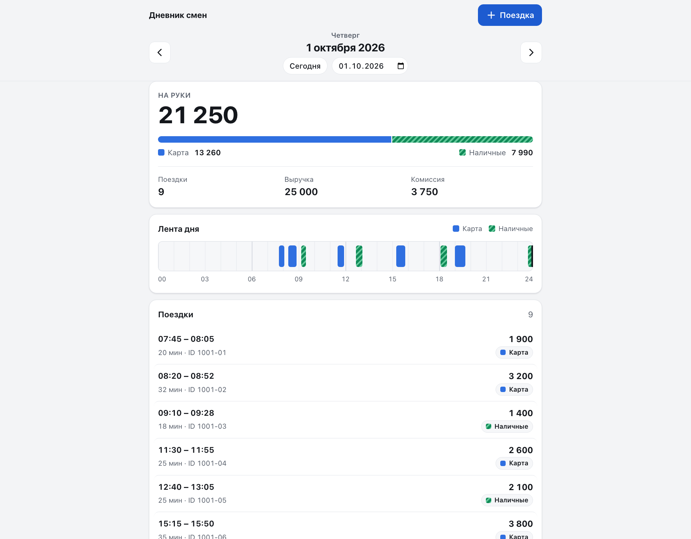
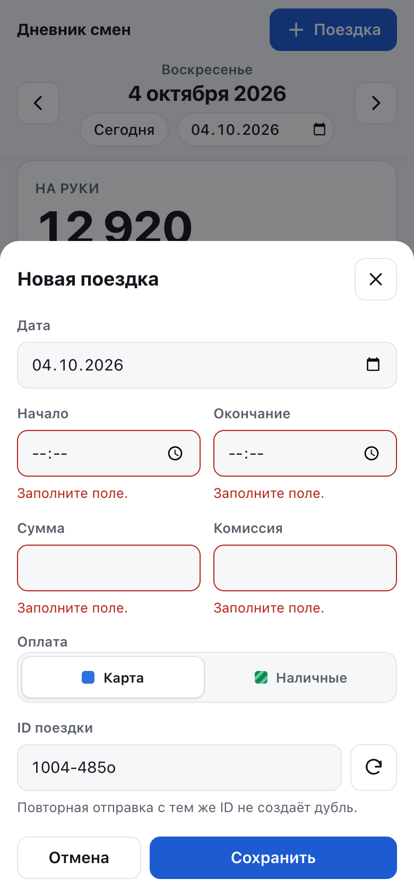
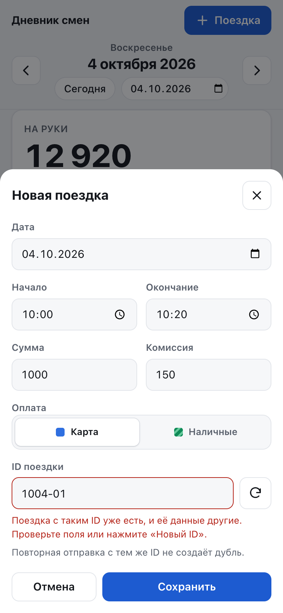
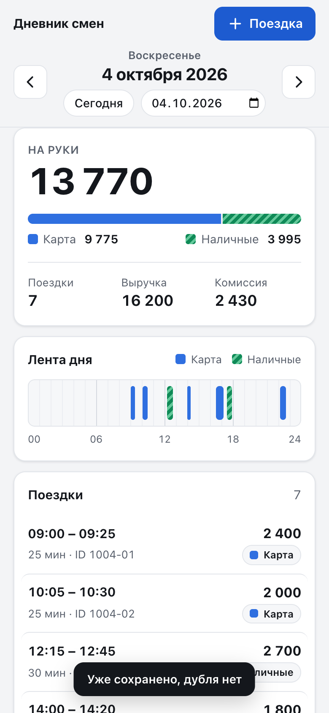

# Скриншоты

Снято на демо-данных из [data/demo-trips.json](../../data/demo-trips.json): их загружает `docker compose up --build`. Живая версия открывается по адресу http://localhost:8000/?date=2026-10-01.

## Телефон, светлая тема

Слева направо:
- обычный день с поездкой через полночь;
- день с паузами;
- пустой день.

## Телефон, тёмная тема

Тема выбирается по системной настройке (`prefers-color-scheme`).

## Десктоп

## Добавление поездки

Ошибки приходят от API и показываются у тех полей, к которым относятся.

<table>
  <tr>
    <td align="center"> Пустая форма: ошибки у полей (422)</td>
    <td align="center"> Тот же ID с другими данными (409)</td>
    <td align="center"> Повторная отправка: «Уже сохранено, дубля нет» (200)</td>
  </tr>
</table>

## Что видно на экране

- **«На руки»** = выручка − комиссия. Полоса под числом делит эту сумму на карту и наличные; у каждой части есть подпись с суммой.
- **Лента дня** — шкала 00–24. Поездки по карте сплошные, наличные в полоску. Поездка через полночь обрезана на 24:00, а в списке у неё пометка «след. день». При наведении или фокусе блок ленты и строка списка подсвечиваются вместе.
- **Время** показано в поясе дня сервера (`+05:00`), а не в поясе браузера. У проверяющего в другом поясе поездки остаются в своём дне.
- **Клавиатура**: ← → листают дни, все элементы доступны через Tab.
